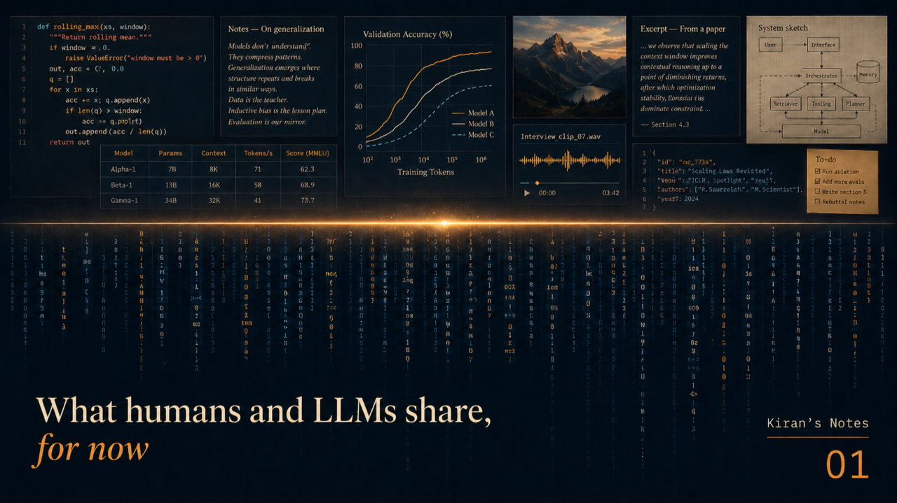
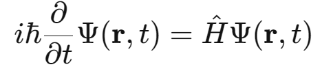
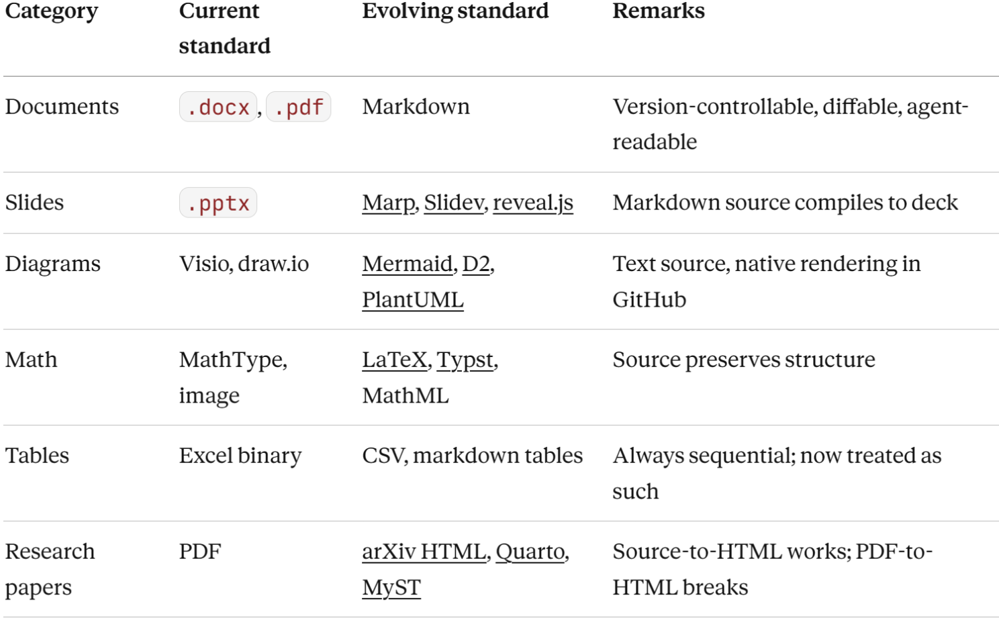

# What humans and LLMs share, for now

*Kiran's Notes — The Common Ground, Foundational Essay (Article 0 of 5)*

**Published in**: *Kiran's Notes* (LinkedIn Newsletter)  
**Original URL**: [LinkedIn Pulse](https://www.linkedin.com/pulse/what-humans-llms-share-now-kiran-kumar-rjcjc/)  
**Author**: Kiran Kumar ([@goelkiran](https://github.com/goelkiran) / [LinkedIn](https://www.linkedin.com/in/kirangoel))  
**Date**: May 16, 2026  

---

<div align="center">
  
</div>

## TL;DR

What humans and LLMs share today is sequential text — Markdown, Mermaid, LaTeX, HTML. Binary documents and screenshots translate poorly into anything an agent can reason about, and the cost is fidelity, time, and meaning at every conversion boundary. The pragmatic shift: treat the text source as the canonical artefact, with renderings — PDF, slides, Figma — as outputs for human readers. The deeper observation is that humans think spatially, and modern LLMs internally infer spatially too, via embeddings in thousands of dimensions. Sequential text is the I/O protocol between us — for now, until the machines learn to see the way humans already do.

## What translation costs us

Every translation between formats loses something. We have always known this. A whiteboard sketch becomes a Figma mock-up. The Figma becomes a Confluence screenshot. The Confluence becomes a PDF for the steering committee. By the time the original idea reaches the people who will execute on it, the colour-coding has drifted, the proportions have shifted, and the meaning of an arrow has become a matter of interpretation.

We accepted these losses for one reason. The readers were all human. A human reader can fill the gaps. They can ask. They can recognise a familiar shape and infer what was meant. Our calendars are filled with meetings to build the shared intuition that our documentation does not quite carry on its own. The costs were not zero — every project manager knows the day-and-a-half lost to a misread diagram — but they were tolerable.

The arrival of agentic AI in our workflows changes the calculation. The new readers are software systems that read what is on the page, no more and no less. They cannot fill gaps from charity or experience. They process exactly what arrives, and what arrives is shaped by every translation that came before it.

Now the cost is not just fidelity. It is also time, and it is meaning. Every conversion between formats — PDF to text, image to OCR, deck to alt-text — runs a pipeline before any reasoning begins. Every pipeline is a place where things break, and meaning leaks out a little at every boundary. This is semantic entropy, and it accumulates. The widely-cited figure is that 70 to 80% of work in an AI engineering pipeline is data engineering itself: changing the modality of the data — media, unstructured text, mixed formats — to improve its semantic conformation before it reaches training or evaluation. The number is a shorthand. The shape of the problem is real. We are paying for the binary era twice — once when we created the artefacts in formats only humans could read, and again when we are forced to translate them into formats everyone can.

## What we built around our minds

Before going further, I want to pause on what we built. Because it is impressive, and it deserves the credit before any of this is questioned.

Mathematical notation is one of humanity's most refined inventions. Look at the Schrödinger equation:

<div align="center">
  
  <p><em>Schrödinger equation</em></p>
</div>

Now consider what is happening in your eyes when you read it. Symbols sit above and below other symbols. A vector lives inside a function that lives inside an equation. The Greek letter on the left and the operator on the right are linked by an equals sign that asserts something profound about how reality unfolds in time. The notation is sparse, dense, and irreducibly spatial. A single line of plain text could not hold the same meaning, even if it carried the same letters.

This is not an accident. The notation evolved to fit how human minds work. We are spatial reasoners. Our visual cortex processes geometric relationships in parallel. The compactness of mathematical notation lets a trained physicist hold a complex thought in one glance — something a paragraph of prose would take longer to spell out and still feel less complete.

The same is true for diagrams. A well-drawn architecture diagram lets you grasp a system's shape before you read its parts. A circuit diagram tells the engineer what to build through layout, not language. A musical score is a control signal for a body.

PDF, Figma, Visio, sheet music, slide decks — these are not arbitrary formats. They are extensions of human spatial cognition. They earned their place by making complex ideas accessible to other humans, fast.

## The chain inside the artefact

We have spent decades managing what happens when ideas travel through a chain of human translators. A business stakeholder describes a need. A product owner translates it into requirements. A business analyst translates the requirements into specifications. A developer translates the specifications into code. Every link is staffed by an intelligent, well-meaning person, and every link still drops something. The classic cartoon of the swing-set — what the customer asked for, what the project manager understood, what the engineers designed, what production supplied — is a different swing-set in every panel, and none of them is the right one.

We invented agile rituals partly to manage this. Stand-ups. Iteration reviews. Three-amigos sessions. The whole apparatus of modern software development is, in part, a control system for translation entropy.

Now look at a typical artefact in a typical enterprise. The architecture lives in a Visio diagram. The data model lives in a PowerPoint slide. The contract lives in a Word document. The tests live in a spreadsheet. The runbook lives in a Confluence page. The code lives in Git.

Six different formats. Six different tools. Each one a translation away from every other one.

This is the same translation chain we know costs us — except it is now inside the artefact instead of inside the team. Until recently, the cost was tolerable because every reader was human and every human reader could re-translate as needed. With agents in the loop, that tolerance ends. The agent does not translate; it operates on what it can read. Whatever it cannot read — or reads imperfectly — falls quietly out of the conversation.

## Where the substrate is heading

By substrate I mean the common ground all readers stand on — the format both humans and agents can read directly, without translation. The substrate is shifting. Three problems sit at the heart of the shift.

First, text and tabular information trapped in non-sequential or binary formats — Word documents, PDFs, PowerPoint slides, Excel files. Second, images and graphs as visual artefacts — Visio diagrams, Figma mock-ups, architecture sketches saved as PNGs. Third, equations rendered as images — mathematics that started as a clean expression and ended up as a flat picture, stripped of structure.

Each problem has an emerging solution.

For documents, the convergence is on Markdown. Plain text. Version-controllable. Diffable. Readable by any agent. Even research papers — long the holdout of PDF-as-final-form — are beginning to shift. arXiv now generates HTML versions of every paper submitted in LaTeX, with the goal of backfilling its corpus of over two million papers. The Allen Institute for AI built a converter called SciA11y to turn PDF papers into HTML and ran into a wall: equations, footnotes, and author affiliations had to be dropped, because PDF had already discarded them at the first conversion. Going forward from source works. Going backward from the binary does not.

For slides, the rumblings are quieter but real. Marp, Slidev and reveal.js compile a Markdown file into a deck. The deck is rendered for humans; the source is text. Versioned, diffable, agent-readable. The PowerPoint file that nobody can edit without the right software becomes a curiosity rather than a default.

For diagrams, Mermaid is now rendered natively in GitHub, GitLab, and most modern documentation platforms. D2 from Terrastruct is gaining ground for designers who want more layout control. Excalidraw added a text-export format. PlantUML has been the elder statesman of text-as-diagram for a long time. None of them is winning at the expense of the others. They are all winning at the expense of the binary file.

For math, LaTeX has been the source-of-record for decades, and the new entrant Typst is gaining ground. Created in 2023, it compiles documents in milliseconds where LaTeX takes seconds or minutes. Its math syntax is meaningfully cleaner. The quadratic formula in LaTeX:

```latex
x = \frac{-b \pm \sqrt{b^2 - 4ac}}{2a}
```

becomes, in Typst:

```typst
$ x = (-b plus.minus sqrt(b^2 - 4a c)) / (2a) $
```

Many universities now accept Typst submissions. Some authors draft in Typst and convert to LaTeX only when a journal requires it.

The whole landscape, in one view:

<div align="center">
  
</div>

What unites all of this is not aesthetic preference. It is a practical observation. The formats that thrive in an agent-readable world are sequential, declarative, and human-editable in plain text. They version-control cleanly. They diff cleanly. They survive copy-paste. And they happen to be readable aloud, which turns out to be its own kind of test.

## What we unlearn, what we learn

This shift asks something of us.

The designer who reaches for Figma as the source has to reconsider. The picture file is now an output of a description, not the description itself. The PM who pastes a screenshot into a ticket has to reconsider. The screenshot is a courtesy to other humans, but the ticket itself needs to live in text the agent can actually read. The BA who owns a Visio diagram nobody else can edit has to reconsider. Ownership of a binary artefact is no longer a sustainable position.

None of this is a complaint about the people doing the work. They built habits that fit the readers they had. The readers have changed.

There is a word worth pausing on. PDF stood for Portable Document Format — portable across machines, from Mac to PC to Linux. The portability was about the device, not the reader. We need a different kind of portability now: across the kinds of minds that read the document. Call it cognitively portable. A format is cognitively portable if both a human and an agent can read it without losing meaning. PDF is not. Markdown is. Most of what we are building toward is, at heart, the search for cognitively portable formats.

The new habit that follows is simple to state, harder to live. Before producing an artefact, ask what the agent will read, and write that. The picture, the slide, the polished export — those become renderings of the source, not the source itself. The Mermaid diagram is the source; the rendered SVG is for humans without a renderer in their browser. The Markdown specification is the source; the PDF is for the steering committee. The LaTeX or Typst paper is the source; the HTML is for the screen reader, the LLM, and the journal reviewer all at once.

Text-first work also forces clarity. There is no font weight to lean on, no whitespace trick to substitute for an argument. The discipline of describing a system in prose is a form of design review. Many of us will write better software because of it.

## Where ambiguity costs the most

The case for format convergence is strongest in domains where accuracy and time both matter. Software engineering and hardware engineering are the obvious ones. Both are disciplines where ambiguity has tangible cost. A misread requirement does not become "an interesting interpretation"; it becomes a defect that ships, or a circuit that fails certification, or a regulatory finding that costs a year of work.

Other accuracy-sensitive disciplines are not far behind. Pharmaceutical research. Aviation. Financial services — my own world. Anywhere the cost of ambiguity is measured in money, safety, or trust, the case for everyone, humans and agents, working in the same substrate is strongest.

I want to be clear about what I am and am not arguing. The architecture diagram still serves the architect. The slide still serves the boardroom. What I am saying is that the visual should be a rendering of a text source, not the canonical thing itself. The visual is a courtesy to human readers. The text is the contract.

## The honest open question

I want to be careful here, because there is a real possibility that everything above describes a transitional state.

There is a reason text was always going to be the natural medium for computers in the first place. Text characters become bytes — ASCII or Unicode. Bytes load into CPU registers — sequential bit-streams. Registers feed sequential instruction execution. The whole computer architecture, from silicon up, is built around streaming sequences of bits. Text aligns naturally with that. A two-dimensional mathematical equation does not. A picture does not. Every other input format requires a translation step before the registers can do anything with it.

That has been the silent constraint shaping the substrate. But the silicon is changing. The CPU was sequential by design — a single-stream processor optimised for branchy, low-latency execution. The GPU brought massively parallel floating-point operations to the mainstream, originally for graphics, then for matrix math at the heart of deep learning. The TPU, which Google has been designing since 2015, is built around a systolic array purpose-fit for tensor operations. The NPU is an inference engine sized for single-digit watts, sitting inside every modern phone. The LPU, newest of the lot, runs entirely on-chip with deterministic compiler-scheduled execution.

Each generation reads more multi-dimensional data as its native unit. The trajectory points somewhere. Neuromorphic chips and optical computing are early but real. Whether the future computer's smallest unit of information remains a sequential byte, or becomes something more spatial — a QR-code-like block, or whatever the equivalent turns out to be — is genuinely an open question.

And here is the deeper observation. Modern LLMs already infer spatially, internally. When a model reads a sentence, it tokenises the text into discrete pieces, then embeds each token as a vector — typically 768 to 12,288 dimensions in current systems. Then attention reshapes every vector by every other vector across the context window. The text was sequential at the input. The model's reasoning is multi-dimensional.

So the actual situation is this. Humans think spatially. LLMs, internally, infer spatially. The sequential text we share between us is the I/O protocol — the agreed format between two systems that have different ways of seeing. It is not the internal substrate on either side. It is the substrate of communication, for now.

That "for now" matters. Whether we should be rewriting our textbooks in LaTeX today, and teaching the source notation to students before they see the rendered form, or whether we should wait for computers to digest spatial information natively, is genuinely open. Time will tell.

What is clear is the direction of work for the next few years. Humans and agents need to share work in a format both can read. Today, that format is sequential text. We optimise for that. We do the unlearning. We accept that we are meeting in the middle of formats — and that the meeting place is plain text, with conventions that work for both sides.

## Onwards

The format question is one part of the picture. There is another, which I will come to next.

Even when the format is right, the location can be wrong. A Markdown specification that lives in a Confluence space far from the code it specifies is, in some ways, worse than a Visio diagram that lives next to the code. The format converged. The location did not. We will look at that next.

---

*This is the foundational essay of The Common Ground series — examining the shift to cognitively portable, text-first artefacts for humans and agents. Published in Kiran's Notes, my LinkedIn newsletter on data engineering, architecture, and the future of software craft.*

---

*#DataEngineering #SoftwareArchitecture #PlainText #Markdown #AgenticAI #ScientificPublishing #SemanticEntropy #KiransNotes #TheCommonGround*
