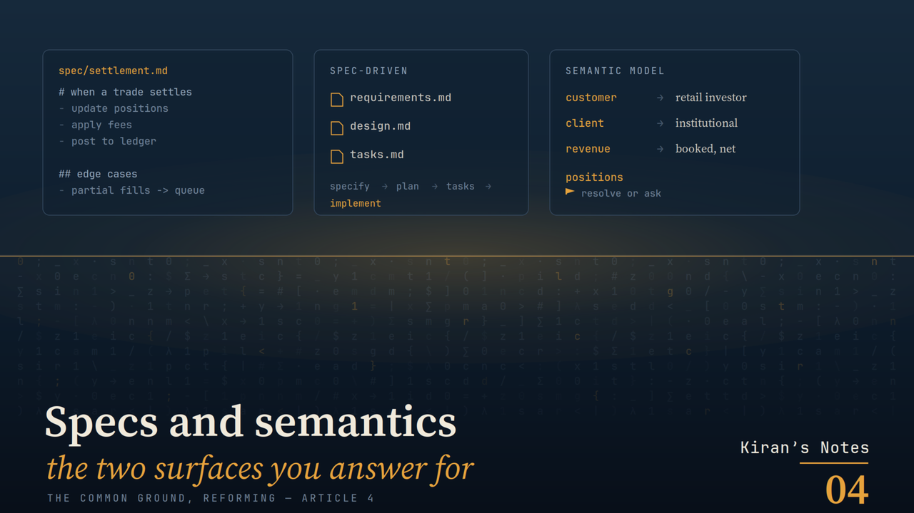
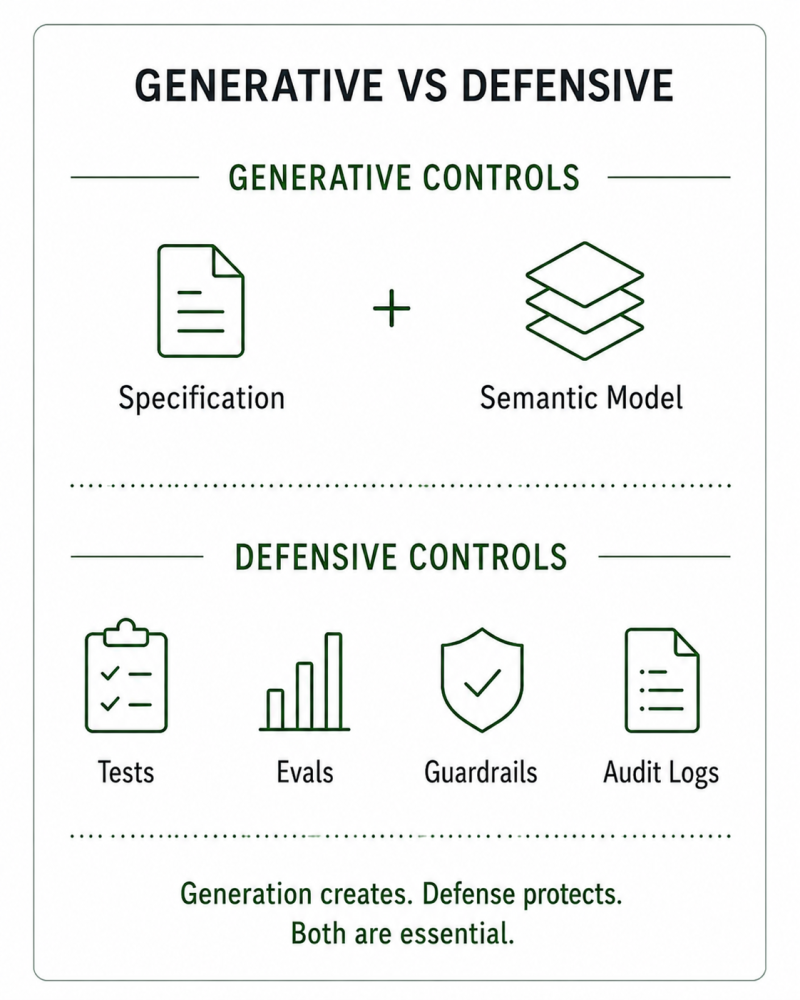
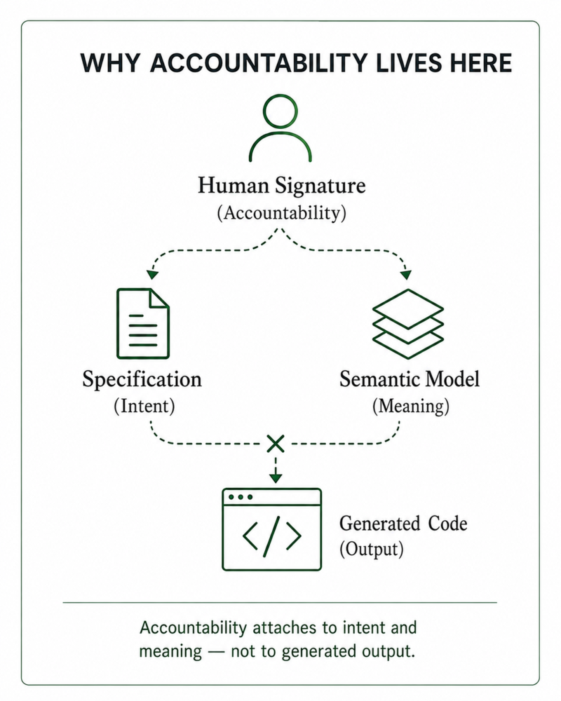

# Specs and semantics — the two surfaces humans must answer for

*Kiran's Notes — The Common Ground, Article 3 of 5*

**Published in**: *Kiran's Notes* (LinkedIn Newsletter)  
**Original URL**: [LinkedIn Pulse](https://www.linkedin.com/pulse/specs-semantics-two-surfaces-humans-must-answer-kiran-kumar-ivltc/)  
**Author**: Kiran Kumar ([@goelkiran](https://github.com/goelkiran) / [LinkedIn](https://www.linkedin.com/in/kirangoel))  
**Date**: June 16, 2026  

---

  

## TL;DR

Three articles cleared the ground: a format both readers can parse, a location the agent can reach, a meaning everyone shares. None of them says what to build. Two human-authored surfaces do. The specification declares what should happen. The semantic model declares what things mean. Both are declarative, both are generative controls — they state what should be true, as opposed to the defensive controls (tests, evals, audit logs) that catch what went wrong — and both stay human. When an agent generates the implementation, these two are the only artefacts a person actually authored, which makes them the only things a person can answer for. Spec-driven development is the name the industry has landed on for the first surface. This piece is about why accountability concentrates on the two, and why the specification is the one that turns intent into software.

## Half a pair

I ended the last article holding half a pair.

The semantic model gives an agent what the words mean — that a customer is a retail investor and a client is an institution, that positions is ambiguous and has to be resolved or asked. That is meaning. It is necessary. It is not sufficient. Knowing what the words mean does not tell you what to do with them. A dictionary is not an instruction.

The other half is the specification. The semantic model declares what things mean; the specification declares what should happen. Build this report. Apply this rule. When a trade settles, update these positions, in this order, with this treatment of the edge cases. One surface is the vocabulary. The other is the sentence written in it.

Put them together and you have what I called last time the twin anchor of the agentic software lifecycle. Both are declarative — they state what should be true, not how to make it so. Both are authored by people. Both are binding on the agent. And both, I want to argue, are the surfaces a human has to stay accountable for, long after the agent has taken over the typing.

## Generative and defensive

There is a distinction worth drawing before going further, because it explains why these two surfaces matter more than the rest.

Some of the controls in a software system are generative. They declare what should be true, before the work is done. The specification is generative — it says what the system should do. The semantic model is generative — it says what the terms mean. They are the source. Everything correct in the system is meant to flow from them.

The rest of the controls are defensive. They catch what went wrong, after the work is done. Tests. Evaluations. Guardrails. Audit logs. Lineage. These are the net beneath the work — and they matter, more than ever, as I will come to. But a net does not decide what should be caught. It reports that something fell. The defensive controls can tell you the system is wrong. They cannot tell you what right was.

  

The generative half is where intent lives. And intent cannot be generated. An agent can write the code, propose the tests, draft the specification itself — but it drafts from what it was given, and the giving is human. Strip a system down to the artefacts that originated with a person, and you are left with two: what should happen, and what things mean. Specs and semantics. Everything else is downstream of them.

## The specification is not new

Before I argue that the specification is becoming the centre of the work, I want to honour what it has always been. The instinct is old, and the people who held it were right.

We have been writing down what software should do for as long as we have built it. The requirements document. The functional spec. Design by contract — Bertrand Meyer's idea that a function should state its preconditions and postconditions as a binding promise. Behaviour-driven development, with its given-when-then, written to force ambiguity into the open before a line of code was cut. Acceptance criteria on a story card. Every one of these was an attempt to capture intent in a form that would survive the journey to implementation.

And every one of them met the same wall. The specification was documentation about the work, kept beside the work, and it went stale the moment the code moved on without it. The agile generation saw this and drew a hard lesson: working software over comprehensive documentation. The heavyweight spec, written once and frozen, had failed the pace of the internet. So the industry learned to travel light — to treat the conversation as the carrier of intent and the document as a cost.

That lesson was correct for its moment. I lived it; I taught it. The spec deserved its demotion, because nobody read it twice.

What changed is the reader.

## Spec-driven development

When the entity reading the specification is an agent, the specification stops being documentation about the work and becomes the work.

This is the shift now travelling under the name spec-driven development. The idea is plain and, once you sit with it, hard to unsee. Instead of prompting an agent for code and hoping the result matches what you meant, you write the specification first. The agent generates a plan from the spec, a set of tasks from the plan, and the implementation from the tasks. The spec is the source of truth. The code is a build artefact of it — the way a compiled binary is a build artefact of source. If the behaviour is wrong, you do not patch the code. You fix the spec and regenerate.

GitHub open-sourced a toolkit for exactly this in September 2025, called Spec Kit. Its workflow is four moves — specify, plan, tasks, implement — and each move produces a Markdown artefact that feeds the next. GitHub's own framing is that we have been treating coding agents like search engines when we should treat them like literal-minded pair programmers: capable, fast, and in need of unambiguous instruction. The spec is how you give it. AWS's Kiro, an agentic development environment released in mid-2025, makes the same bet from the other end: describe a feature and it generates three files — a requirements document, a design document, a task list — and treats those as the source of truth the code is built from.

Notice what these tools converged on without coordinating. The artefacts are Markdown — the cognitively portable format of Article 1. They live in the repository, next to the code they govern — the co-location of Article 2. And they carry meaning the rest of the system has to respect — the declared layer of Article 3. The two surfaces are being built into the tools, in the format and the place the first three articles argued for. I did not plan the series to land here. The tools arrived on their own, which is the better kind of confirmation.

There is a deeper reason the specification has to carry more now than it used to, and it turns on what happens to communication when one party can no longer ask a clarifying question. That is a thread I will pull properly in a later article. For now it is enough to say the spec has to carry the whole message, because the reader cannot tap you on the shoulder.

## Why accountability lives here

Here is the part that matters most, and it is not a tooling point. It is an accountability one.

In the world I work in — investment management, where a misread position becomes a misreported number to a regulator — someone has to be able to sign their name to what a system does. That signature has never meant "I typed every line." It has meant "I understand this, I vouch for it, and if it is wrong I am answerable." Accountability is the ability to explain and to stand behind.

Now ask what a person can honestly sign for once an agent wrote the implementation. Not the code, line by line — they did not write it, and in a large system cannot read all of it. What they wrote, and can stand behind, is the intent and the meaning: the specification that said what should happen, and the semantic model that said what the terms meant. Those are the artefacts with a human author. Those are the surfaces where a signature attaches to something a person actually did.

  

This is why the generative half cannot be handed off. You can let the agent draft the spec — most teams will — but a human has to read it, own it, and answer for it, because it stands in for every line generated beneath it. The defensive controls still matter; I would argue they matter more in an agentic world, and I have written elsewhere in this newsletter about why regulatable, auditable systems are not optional in regulated domains. But the net does not absolve the author. The tests tell you whether the system matches the spec. Only a person can tell you whether the spec was right.

So the two surfaces are not merely where the human still works. They are where the human has to remain answerable — because they are the only places where what a human declared and what the system does are still the same thing.

## The role this leaves

If implementation is generated and intent is authored, the centre of gravity of the job moves.

I have written before about the intent engineer — the role that emerges when writing code stops being the scarce skill, and specifying what to build, precisely enough that an agent builds it correctly, becomes the scarce one. The name matters less than the shift it points at. The valuable work moves up the stack, from how to what and why. From implementation to specification. From writing the sentence to deciding what the sentence should say, and making sure every word in it means what you think it means.

That is not a smaller job. It is a harder one. Vague intent has always produced bad software; it used to fail slowly, filtered through human translators who caught some of the ambiguity on the way down. The agent does not filter. It builds what the spec says, at speed. Which puts the weight back where it belongs — on the clarity of the intent and the discipline of the meaning.

## Onwards

Four articles, and the shape is now visible. A format both readers can parse. A location the reader can reach. A meaning everyone shares. And, sitting on all three, the two surfaces a human authors and answers for: the specification, which says what should happen, and the semantic model, which says what things mean. Generative controls, both. The human half of the work.

But a specification has a failure mode older than agents, and writing it well is not enough to defeat it. A spec written once and filed begins, immediately, to lie — because the code keeps moving and the intent does not follow it. The first three articles got the spec into the right format, the right place, the right vocabulary. None of that keeps it true. Keeping intent alive while the system changes underneath it is its own discipline, and it is where I want to go next.

Next: a specification set aside is a specification that lies — keeping intent alive while the code keeps moving.

---

*#SpecDrivenDevelopment #SoftwareSpecs #SemanticLayer #AIGovernance #AgenticAI #DataEngineering #KiransNotes #TheCommonGround*
