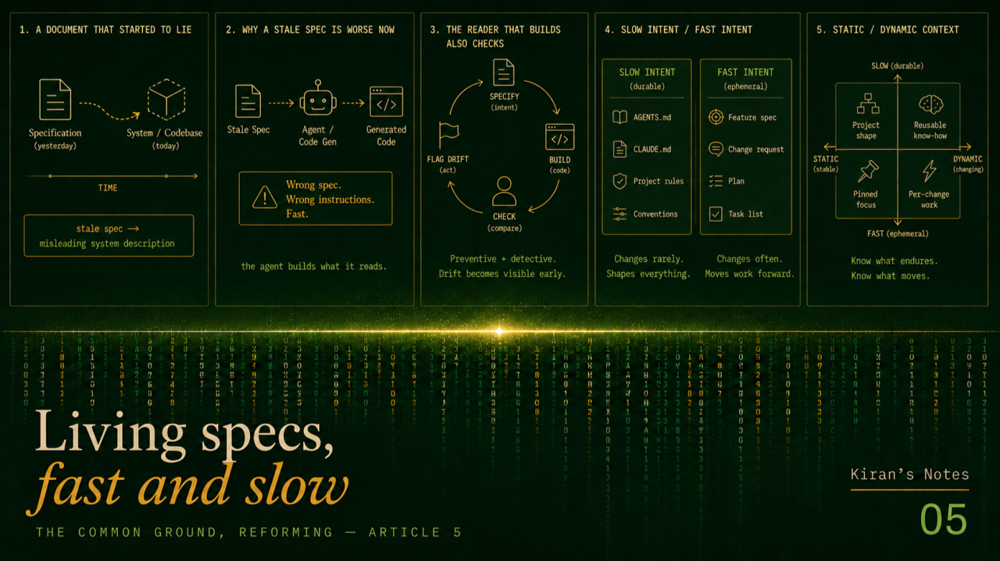
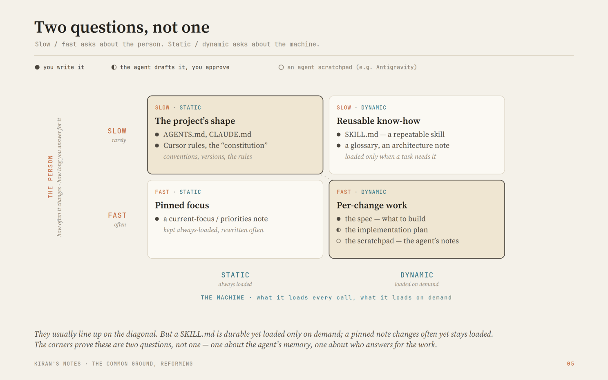

# Living specs, fast and slow

*Kiran's Notes — The Common Ground, Article 4 of 5*

**Published in**: *Kiran's Notes* (LinkedIn Newsletter)  
**Original URL**: [LinkedIn Pulse](https://www.linkedin.com/pulse/living-specs-fast-slow-kiran-kumar-rqq5e/)  
**Author**: Kiran Kumar ([@goelkiran](https://github.com/goelkiran) / [LinkedIn](https://www.linkedin.com/in/kirangoel))  
**Date**: June 24, 2026  

---

  

## TL;DR

Write down what a piece of software is meant to do, then stop updating it, and within weeks the document describes software you no longer have. Documents going stale is an old problem. What changes now is who reads them. When an agent builds the code straight from your written intent, a stale spec is not a tired document a person can second-guess — it is a wrong instruction the agent follows at speed. So intent has to stay alive. This piece splits the problem in two: slow intent, the durable shape of a project you write once and live with, and fast intent, the spec for a single change that lives and dies with it. The twist is that the same agent that made stale intent dangerous is the first tool cheap enough to keep it from going stale.

## A document that started to lie

Years ago I wrote a careful design document for a data platform. It was good on the day I wrote it. Over the next year the system kept moving — new sources, changed rules, a migration here and there — and the document did not move with it. By the time a new engineer joined and read it, it described a system that no longer existed. He spent the better part of a week building on things that had been true once and were not true now.

The document had not just gone out of date. It had started to mislead. A blank page would have been kinder, because a blank page does not pretend to know.

Every engineer has a version of this story, and we made our peace with it. We had a workaround. A human reader can sense when a document feels off. They can ask the person at the next desk, or open the code and check. The document was a starting point, not the last word.

Then the reader changed.

## Why a stale spec is worse now

A growing share of software is now built like this: you describe what it should do, in plain words, and an agent builds it from your description. The description — the spec — is the part you author. The code is what comes out the other side.

When the code is built from the spec, a stale spec stops being a tired document and becomes a wrong instruction. The agent does not pause and wonder whether the spec still matches reality. It reads what is in front of it and builds that, fast. A person reading an out-of-date runbook at least frowns. The agent does not frown. So the gap that opens between what we wrote down and what the system actually does — the thing we have always called drift — stops being a quiet mess in a wiki and becomes something that ships.

There is an odd upside hiding in this, though, and it is worth seeing. In the old way of working, the code was the truth and the document drifted away from it. Now the spec leads and the code follows. So the question we are left with changes. It stops being "is the documentation up to date with the code?" and becomes "is the spec still what we actually want?" That second question is a better one to be holding. One is bookkeeping. The other is about what you meant.

## The one spec we already keep alive

Before going further, it is worth noticing that we already keep one kind of specification alive, and have for years. The test suite.

A test is a small, exact statement of what the code should do: given this input, expect that result. What makes a test different from a design document is that it runs. When someone changes the code and the behaviour no longer matches, the test fails — loudly, in front of the whole team. A test cannot quietly go out of date. The moment it stops being true, it says so.

This is the one corner of our work where the description and the thing it describes are kept in step on their own. Not by discipline. By the fact that the description is something a machine can run. The idea has a history worth knowing, and it has a name. Behaviour-driven development, with its plain "given, when, then" phrasing, and tools like Cucumber that turn those sentences into checks a machine can run, were all reaching for the same thing: a description of behaviour that a non-programmer could read and a computer could test. Gojko Adzic called the goal "living documentation" — writing that stays true because it is wired to the code it describes.

The lesson is simple. The specification we trust over time is the one that cannot lie without setting off an alarm. So the question for everything else we write down — the prose spec, the project's rules — is whether we can give it some of that same quality. Whether we can make written intent that checks itself.

## The reader that builds is also the reader that checks

Here is the part I find most interesting, and it is a small reversal.

The agent is the reason drift turned dangerous. It builds from the spec at speed, so a wrong spec becomes wrong software fast. But the same agent is the first tool cheap enough to stop the spec and the code from drifting apart in the first place.

Think about why drift was ever allowed to happen. Keeping a document in step with a moving codebase was slow, dull, manual work, and it was the first thing dropped whenever a deadline came close. Nobody had time to read the whole system and check it against the whole spec on every change. So nobody did, and the gap crept in a little at a time.

An agent does have the time. It can read the entire codebase and the entire spec in one pass. It can compare what the spec says against what the code actually does, and point out the difference the moment a change opens one — in the same pull request, before anything ships. The never-ending job of keeping intent and reality in step is exactly the kind of job an agent is good at.

There is an old pair of words for this, borrowed from the audit world. A preventive control stops a problem before it happens; a detective control catches one after it appears. The spec is the preventive side — it states what should be true. The agent reading spec against code is the detective side — it shows you when the two stop matching. You want both. For the first time, the second one is cheap enough to run on every single change rather than once a quarter, if ever.

## Slow intent and fast intent

Once you decide to keep intent alive, you notice it does not all move at the same speed. It helps to split it in two.

Some intent is slow. It is the durable shape of a project — the conventions, the tools and the versions you have settled on, the lines you do not cross, the way this particular team builds things. It changes rarely. You write it once and live with it for months. This is the intent that now lives in a context file: a plain text file at the top of a project that tells any agent how the project is set up and how to work in it. These files have settled on a few names — AGENTS.md, CLAUDE.md, the rules files a tool like Cursor reads. Spec Kit calls its version a "constitution"; Kiro, the agent development tool from AWS, calls them "steering files." It is, in effect, the README finally written for the new kind of reader as well as the human one. The pattern has spread far enough that AGENTS.md was handed to the Linux Foundation in late 2025 as a shared standard, which is usually the sign that something has stopped being a fad.

There is a catch worth saying plainly, because the instinct is to pour everything into this file. A 2026 study from ETH Zurich found that fat context files — full of things the agent could have worked out for itself — often made agents worse, not better. More to read, more to keep current, more to drift. The version that earns its keep is short: the things the agent cannot guess. The exact build command. The version it must not stray from. The rule that the code does not reveal on its own. Slow intent works by being small and true, not long.

Other intent is fast. It is the spec for one change — this feature, this fix — and it lives and dies with that change. You write it, the agent builds from it, the change ships, and that spec has done its job.

Engineers have a related split, and it is worth naming so the two are not mixed up. They talk about static and dynamic context. Static is what an agent loads every single time it works — the rules files. Dynamic is what it pulls in only when a task calls for it — a particular document, a particular tool. That line is drawn around the machine: what gets loaded, and what it costs to load. The line I am drawing — slow versus fast — sits one step back from the machine, at the person: how often the intent itself changes, and how long you are on the hook for it. The two usually line up, because slow intent tends to be the always-loaded kind. But they answer different questions. Theirs is about the agent's memory. Mine is about who is responsible, and for how long.

  
  
<em>Slow/Fast vs Static/Dynamic Context</em>

If slow/fast and static/dynamic were the same line, only the diagonal could ever be filled. A SKILL.md is durable yet loaded only on demand; a pinned note changes often yet stays loaded — the corners that aren't empty are the proof these are two questions, one about the agent's memory and one about who answers for the work.

## Meaning drifts too

Code is not the only thing intent can fall out of step with. Meaning drifts as well, and it deserves a flag here even though it earns a piece of its own another day. The shared definitions a project leans on — what counts as an active customer, where one region ends and the next begins — slide quietly as the business changes, and a definition that is no longer true is its own kind of stale spec. The cure rhymes with the one above: keep the definitions where the work can see them, and let an agent check them against how they are actually used. But meaning goes wrong more slowly and more quietly than code does, so I will come back to it properly.

## A signature on a stale spec

I want to end where this matters most, which is not tidiness.

In a regulated business — mine is one — someone has to be able to put their name to what a system does and explain it later, to a colleague or to an auditor. That signature rests on the written intent, because the spec is the thing a person actually authored and can stand behind. But a signature on a spec that no longer matches the running system is worth nothing. If the document and the software have drifted apart, you are vouching for something that is not the thing in production. Your name sits on a description of a system that no longer exists — which is exactly where my new colleague found himself, a week in.

So keeping intent alive is not housekeeping. It is what keeps your accountability real. The day the spec stops matching the code is the day your earlier promise quietly lapses. In a regulated shop that is not a figure of speech. It is the precise gap an audit exists to find.

Both timescales have to stay true, then. And the cheapest place to keep them true is now built into the same agent that put them at risk. Write the slow intent small, and keep it honest. Write the fast intent for each change, and let it go when the change ships. And let the tireless reader that builds your software be the one that checks, on every change, that the software still says what you meant.

## Onwards

There is one more thing that changes once your reader can no longer turn around and ask you what you meant. When there is nobody to clarify, the whole of your meaning has to travel inside the message itself. That is a different way of writing, and it is older than software. It is where I want to go next.

Next: the whole message — what writing has to carry when the reader can't ask.

---

*#SpecDrivenDevelopment #LivingDocumentation #ContextEngineering #AgenticAI #SoftwareEngineering #DataEngineering #KiransNotes #TheCommonGround*
