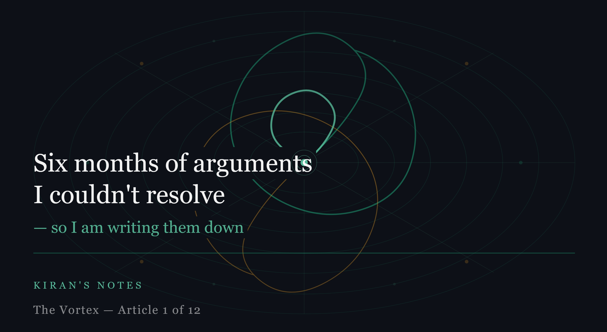

# Six months of arguments I couldn't resolve — so I am writing them down

*Kiran's Notes — The Vortex, Article 1 of 12*

**Published in**: *Kiran's Notes* (LinkedIn Newsletter)  
**Original URL**: [LinkedIn Pulse](https://www.linkedin.com/pulse/six-months-arguments-i-couldnt-resolve-so-am-writing-them-kiran-kumar-lndoc/)  
**Companion Graphic**: [TheVortex-01.jpeg](../assets/TheVortex-01.jpeg)  
**Companion PDF**: [TheVortex-01.pdf](../assets/TheVortex-01.pdf)  
**Author**: Kiran Kumar ([@goelkiran](https://github.com/goelkiran) / [LinkedIn](https://www.linkedin.com/in/kirangoel))  
**Date**: April 13, 2026  

---

  

Every system, human or machine, eventually faces the same dilemma: explore or exploit: try something new and uncertain or stick with what already works?

For the last six months, my teams and I have been stuck in exactly this dilemma. Not in code. In the room.

It started, as most interesting problems do, with a meeting that wasn't supposed to be interesting.

A design review. One of many my leadership team sit through each month. A senior lead was pushing the team to consolidate — fewer services, tighter coupling, faster delivery. The engineers were pushing back. Not with resistance. With something more interesting: possibility. "We can do things now we couldn't six months ago," one of them said. "The tools have changed. Why are we designing like they haven't?"

The room went quiet in that particular way that means everyone is thinking and no one wants to be the first to say something wrong.

I didn't resolve it that day. I noted it and moved on.

Then it happened again. A different team, a different project, almost the same conversation. Then again. Then again. By the fourth time, I stopped treating it as a disagreement to be mediated and started treating it as a signal worth understanding.

---

The signal was this: **We are designing with yesterday’s constraints in a world that no longer has them.**

Then came the question I haven't been able to stop thinking about.

I was in a retrospective with a quality engineering team — sharp people, experienced, the kind of testers who think in edge cases and failure modes as naturally as the rest of us think in features. One of them leaned back and asked, almost casually:

> *"If the developer is using AI to write code, and QA is using AI to test it; are we testing anything at all or are we just validating each other's assumptions?"*

Nobody laughed. Nobody dismissed it. We sat with it for a while, and then the meeting ended, and I drove home with that question sitting in the passenger seat.

It is still there.

---

I want to be clear about what this series is — and what it isn't.

This is not a prediction. I am not going to tell you that microservices are dead, or that agile is finished, or that software engineers will be replaced by agents within three years. I have sat in enough rooms to know that confident proclamations about the future of software tend to age about as well as confident proclamations about the future of anything.

What this is, is a reflection — documented while it is still unresolved. I am writing these pieces because the questions my teams are raising deserve more than a retrospective action item. They deserve to be thought through carefully, in public, where other practitioners can push back, add context, and share what they are seeing in their own rooms.

Over the next several days, I will be publishing multiple articles that explore what I think is a genuine inflection point in how software is built, by whom, and according to what principles. The themes will range from the history of why we build software the way we do, to the economics that shaped it, to the new participant entering the picture that doesn't follow any of the rules we wrote.

I am calling the underlying idea **the vortex** — a term I'll explain properly in the next piece. The short version: hardware, software, and development practices have always evolved together, each advancement creating the foundation and the appetite for the next. That vortex is spinning again. Faster than before. And something new has entered it.

If you work in software — as an engineer, an architect, a lead, a quality practitioner, a product manager, or any of the dozen other roles that orbit the act of building things — I think at least some of these questions will feel familiar. You may have sat in a version of my design review. You may have your own version of the quality engineer's question.

I don't have clean answers. But I have found that the right questions, asked in good company, have a way of generating something more useful than answers — they generate the kind of thinking that actually moves things forward.

So here we go. For now, we’re choosing to explore — even if it means admitting we don’t fully understand what we’re building anymore.

---

*Are you seeing this in your teams? Comments, pushback, and your own version of the argument are very welcome.*

**Next**: *Hardware, software, and money — the vortex that built the digital economy.*

---

*This is Article 1 of The Vortex — a 12-part series on how agentic AI is forcing us to rethink the software development lifecycle from first principles. Published in Kiran's Notes, my LinkedIn newsletter on data engineering, architecture, and the future of software craft.*

---

*#SoftwareDevelopment #SDLC #AgenticAI #TechLeadership #DataEngineering #FutureOfWork #SoftwareArchitecture #ReinforcementLearning #TheVortex*
