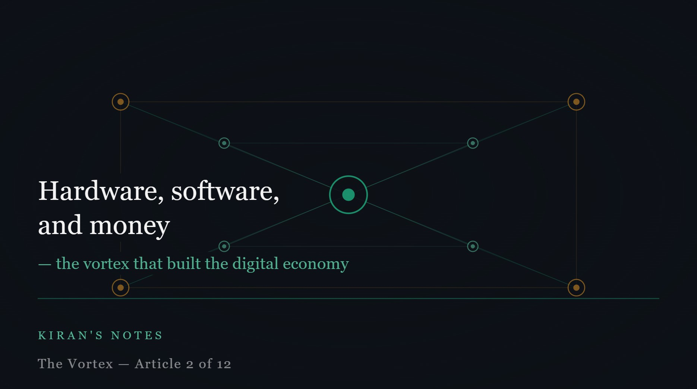

# Hardware, software, and money — the vortex that built the digital economy

*Kiran's Notes — The Vortex, Article 2 of 12*

**Published in**: *Kiran's Notes* (LinkedIn Newsletter)  
**Original URL**: [LinkedIn Pulse](https://www.linkedin.com/pulse/hardware-software-money-vortex-built-digital-economy-kiran-kumar-2whsc/)  
**Companion Graphic**: [TheVortex-02.jpeg](../assets/TheVortex-02.jpeg)  
**Author**: Kiran Kumar ([@goelkiran](https://github.com/goelkiran) / [LinkedIn](https://www.linkedin.com/in/kirangoel))  

---

  

Before I can argue that something is changing, I need to explain what was built in the first place. And to explain that, I need to introduce a metaphor I'll be using throughout this series.

I call it the vortex.

---

## Three characters, one spinning system

In the early days of computing, three characters dominated the story: processing power, storage, and connectivity. CPU, disk, and network. Each was expensive, slow, and scarce. And because they were scarce, every decision made around them was a decision about conservation.

You stored only what you had to. You processed only what you couldn't avoid. You connected only what was physically nearby.

Then something interesting happened. Each character got cheaper. Then faster. Then cheaper again. And every time one of them improved, it created new possibilities for the other two — which pulled investment, which created more improvement, which created more possibilities.

This is the vortex. Not a straight line of progress, but a spinning system where each advancement fuels the next. Hardware improvements enabled new software patterns. New software patterns created demand for better hardware. The economics of both attracted capital, which funded the next generation of both.

I have watched this vortex spin across twenty years of building data platforms for investment management firms across London, New York, Frankfurt, and Gurugram. Every architectural decision I have made — every platform we built, every migration we survived — was made inside this spinning system, whether we named it that or not.

---

## The economy the vortex built

Here is what the vortex produced, and it is worth pausing to appreciate the scale of it.

The five most valuable companies in the world today — Apple, Microsoft, NVIDIA, Alphabet, Amazon — are all fundamentally software and data businesses. They exist because the vortex made it possible to build at a scale that was previously unimaginable. Google's search engine processes billions of queries a day on infrastructure that costs a fraction of what it would have cost twenty years ago. Meta stores and serves photo and video content at a scale that would have required a city-sized data centre in 2000.

The digital economy did not just create new companies. It created entirely new categories of economic activity. E-commerce is not a faster version of a catalogue store — it is a fundamentally different system enabled by real-time inventory data, distributed fulfilment logistics, and payment infrastructure that required decades of technology investment to make reliable. Uber is not a faster taxi — it is a data platform that matches supply and demand in real time across millions of participants simultaneously. Food delivery, streaming entertainment, cloud-based enterprise software — none of these exist without the vortex spinning hardware, software, and capital together across decades.

---

## The offshore wave was part of the vortex too

Here is something we rarely say plainly: the globalisation of software engineering was also a product of the vortex.

As network infrastructure improved through the 1990s and 2000s, the cost of coordinating work across geographies fell dramatically. This made it economically viable — and then competitively necessary — to build engineering teams in India, China, Eastern Europe, and elsewhere. Lower costs, growing talent pools, and improving connectivity made the offshore model work.

I am part of that story. I started my career at Infosys, working on systems for Deutsche Bank in London and UBS in New York, from offices in Bangalore. The work was real, the impact was real, and the model enabled companies to scale engineering capacity in ways that would have been impossible if every engineer had to sit in the same building in the same expensive city.

The offshore wave created an enormous global workforce of software engineers. Hundreds of thousands of professionals, across dozens of countries, all contributing to the same digital economy. By the 2010s, this army of engineers was the defining resource of the technology industry.

How you organise and coordinate an army of engineers at that scale — that became the central engineering problem of the era. And the answer that the industry converged on was microservices and agile.

But that is the next article.

---

## The vortex never stops

The reason I find this history important is not nostalgia. It is because the vortex is still spinning.

The same dynamic that turned cheap silicon into a global digital economy is now incorporating a new character. A fourth one. And when a new character enters a spinning vortex, the system does not slow down to accommodate it. It accelerates.

I will come to that in time. For now, it is enough to appreciate what the first three characters built together — and to recognise that we are standing on top of something extraordinary, debating how to rearrange the furniture, while the ground beneath us is still moving.

*Next: Agile and microservices were invented for people, not for machines.*

---

---
*#DataEngineering #DigitalEconomy #SoftwareArchitecture #TechLeadership #KiransNotes #TheVortex*
