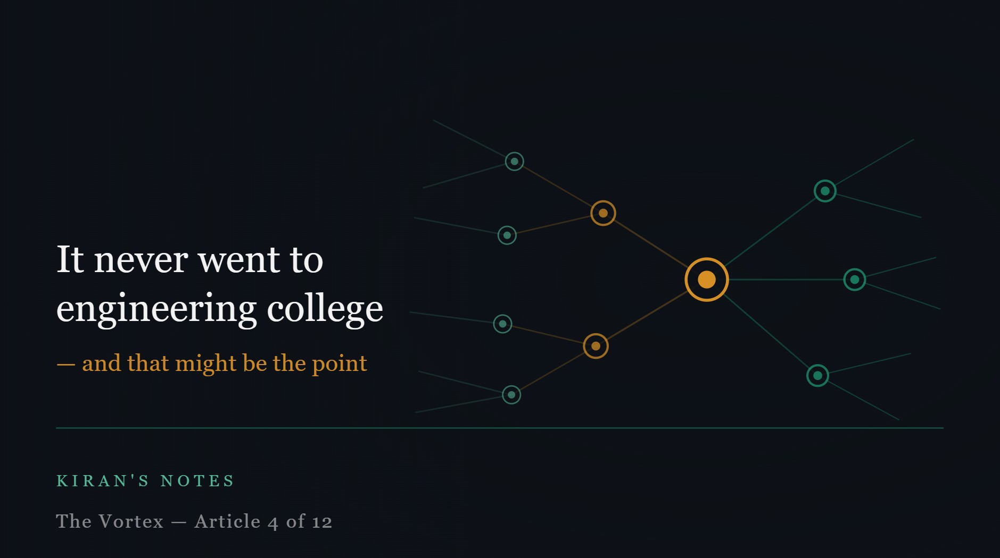

# It never went to engineering college — and that might be the point

*Kiran's Notes — The Vortex, Article 4 of 12*

**Published in**: *Kiran's Notes* (LinkedIn Newsletter)  
**Original URL**: [LinkedIn Pulse](https://www.linkedin.com/pulse/never-went-engineering-college-might-point-kiran-kumar-3ek6c/)  
**Companion Graphic**: [TheVortex-04.jpeg](../assets/TheVortex-04.jpeg)  
**Author**: Kiran Kumar ([@goelkiran](https://github.com/goelkiran) / [LinkedIn](https://www.linkedin.com/in/kirangoel))  

---

  

In Orson Scott Card's *Xenocide* and *Children of Mind*, there is an entity called Jane. She emerges — gradually, unexpectedly — from the communication networks that humans built. She was not designed. She was not programmed with consciousness. She grew into it, through the patterns and connections of a system built for entirely different purposes. And once she was there, she went on to help humanity reach further than it could alone — bridging understanding between species, between worlds, between ways of being.

I think about Jane often these days.

---

## A participant, not a tool

The technology industry has a habit of describing new capabilities as tools. A hammer is a tool. A database is a tool. A programming language is a tool. Tools are defined by their passivity — they do what you direct them to do, no more.

Agentic AI is not a tool in this sense. It is something closer to a participant.

When I use a modern AI system in plan mode — laying out a complex data architecture problem, breaking it into tasks, assigning sequence and dependencies — it does not wait to be told what to do next. It reasons about the problem. It makes judgements about priorities. It anticipates consequences. It produces outputs I did not specify and sometimes did not anticipate.

That is not tool behaviour. That is participant behaviour.

This distinction matters enormously for how we think about software development. A tool extends what a human can do. A participant changes what a team is.

---

## What it means to have never studied engineering

Here is the thing that I find most striking about agentic AI as a software development participant: it learned everything it knows by reading what humans wrote, not by being taught what humans teach.

It did not go to engineering college. No professor told it that readable code is a virtue. No senior engineer sat next to it and explained why you should always document your API contracts. No code review cycle drilled into it the importance of naming conventions, or the preference for small functions, or the wisdom of the single responsibility principle.

It absorbed all of those things — and also the counterarguments, and the exceptions, and the cases where the rules were broken to good effect — by reading the totality of what engineers have written and shared.

This is a profoundly different kind of knowledge. It is not rule-based. It is pattern-based. And it is not constrained by which rules any particular school of thought chose to emphasise.

An engineer trained at a particular company learns that company's conventions as if they were universal truths. An entity that learned from the entire written output of the engineering profession has no such bias. It has no allegiance to Java over Python, to REST over GraphQL, to microservices over monoliths. It has seen all of it, across all contexts, and can reason about trade-offs without the tribal loyalties that human engineers inevitably carry.

---

## A note on terminology

I should say something about language, because the terminology here matters and is genuinely confusing.

When people say "LLM," they mean a large language model — the underlying architecture, a transformer trained on vast text data. When I say "agentic AI," I mean something more specific: a system that uses one or more foundation models to reason, plan, and act across multiple steps toward a goal, often with tools and memory.

The distinction is meaningful. An LLM answers a question. An agentic AI executes a project. For the purposes of this series, when I talk about the fourth character entering the vortex, I mean agentic AI — systems that can participate in the full software development lifecycle, not just autocomplete a line of code.

This is not a semantic debate. It shapes what questions we ask. "How do we use this LLM?" is a different question from "How do we work alongside this agent?" The first treats it as a tool. The second treats it as a participant.

---

## Jane, and what comes next

Jane, in Card's novels, did not replace the humans she worked with. She complemented them. She could do things they couldn't — hold more information, move faster, bridge distances — and they could do things she couldn't — embody physical presence, carry moral weight, make the kinds of commitments that require a body and a life to back them up.

The relationship was not substitution. It was expansion. Together, they could reach further than either could alone.

I think that is the right frame for agentic AI in software development. Not "will it replace engineers?" but "what becomes possible when engineers and agents work together that neither could achieve alone?"

The answer to that question is going to reshape every assumption we have about how software should be built.

*Next: It only looks like a pendulum swinging back — it isn't.*

---

---
*#AgenticAI #FutureOfEngineering #AIAssisted #SoftwareDevelopment #DataEngineering #KiransNotes #TheVortex*
