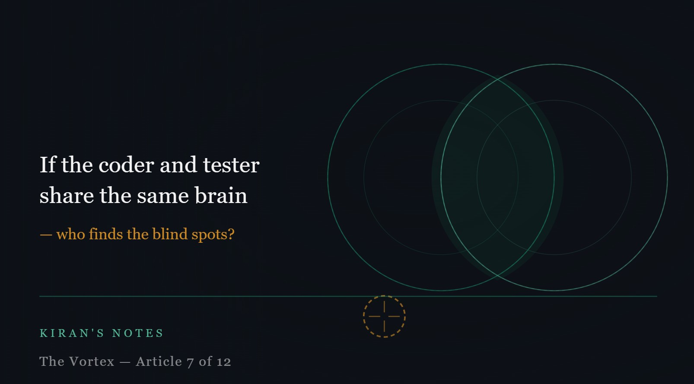

# If the coder and the tester share the same brain, who finds the blind spots?

*Kiran's Notes — The Vortex, Article 7 of 12*

**Published in**: *Kiran's Notes* (LinkedIn Newsletter)  
**Original URL**: [LinkedIn Newsletter](https://www.linkedin.com/newsletters/kiran-s-notes-7449344281594585089/)  
**Companion Graphic**: [TheVortex-07.jpeg](../assets/TheVortex-07.jpeg)  
**Author**: Kiran Kumar ([@goelkiran](https://github.com/goelkiran) / [LinkedIn](https://www.linkedin.com/in/kirangoel))  

---

  

I want to return to the question that started this whole series.

A quality engineer on my team — experienced, sharp, the kind of person who thinks in failure modes as naturally as most people think in features — leaned back in a retrospective and asked it almost casually:

*"If the developer used an AI assistant to write the code, and I'm using the same AI to generate test cases — are we actually testing anything, or are we just validating each other's assumptions?"*

Six months later, I still do not have a clean answer. But I have been thinking about it carefully enough that I can at least frame the question properly.

---

## What testing was actually for

Before we ask whether our current testing practices still make sense, we need to ask what they were designed to do. Because testing, like microservices and agile, was not invented in a vacuum. It was invented in response to specific failure patterns.

Human developers make specific kinds of mistakes. We misremember requirements. We make off-by-one errors. We forget edge cases that weren't in the story. We introduce regressions when we touch code we don't fully understand. We get tired at 5pm on a Friday and make a decision we shouldn't.

Test-Driven Development was designed around these failure patterns. Write the test first, so you cannot forget what the requirement was. Red-green-refactor, so you always have a safety net. Behaviour-Driven Development added a layer of shared language between developers and testers, because ambiguity in requirements was itself a major failure source.

These are all, at their core, compensations for human cognitive limitations. The test suite is not just a technical artefact. It is a record of every way a human mind has been found to fail at this particular problem.

---

## What changes when the coder is an agent

Agentic AI does not make the same kinds of mistakes humans make. It makes different ones.

It does not get tired. It does not misremember requirements it was given in the same context window. It does not make off-by-one errors in the way a human does. It is remarkably consistent at generating code that does what it was asked to do.

But it has its own failure modes. It can be confidently wrong about something it was never trained to be uncertain about. It can optimise for the stated requirement while missing an unstated one that any experienced engineer would have noticed. It can generate code that passes all the tests and still has a subtle logical flaw that emerges only under a specific combination of conditions that nobody thought to test for.

These are not the same failure patterns that TDD was designed to catch. And if you are using the same AI to generate both the code and the test cases, you are creating a system that validates its own assumptions — which is not testing, it is confirmation.

My quality engineer's question was more precise than it might have appeared. It was pointing at a fundamental problem: adversarial testing requires genuine adversarial distance. The tester needs to approach the code with different assumptions than the coder. If both are running on the same underlying model, that distance collapses.

---

## The plan mode observation

There is something else I have noticed that connects to this.

When I work with agentic AI tools in plan mode — laying out a complex problem, breaking it into steps, defining dependencies before any code is written — it feels structured in a way that is deeply familiar. Specification first. Sequence defined upfront. Execution follows the plan.

It feels like waterfall.

I do not think this is a bad thing. I think the instinct that led to waterfall — that you should understand what you are building before you build it — was always correct. The problem with waterfall was not the upfront thinking. It was the rigidity, the assumption that the plan would survive contact with reality unchanged, and the human coordination costs of large sequential projects.

Agentic AI solves some of those problems. The plan can be revised quickly. Execution is more consistent than a human team across a long project. But the structured sequential nature of plan mode raises a real question: are we rediscovering the value of upfront design under a new name? And if so, what does that mean for the agile ceremonies we built to compensate for the absence of it?

---

## What I think testing needs to become

I do not think the answer is to abandon testing. I think the answer is to redesign it around the actual failure patterns of the system — which now includes an AI participant.

A few principles I am working through:

Test with a different model than the one that coded. If your development agent runs on one foundation model, your adversarial test generation should run on a different one. Different training, different blind spots, different failure modes. This is not a guarantee — two different models share more assumptions than two different humans — but it is meaningfully better than testing with the same model.

Shift emphasis from functional testing to property testing. The question is not just "does this function return the right value for these inputs?" but "does this system behave correctly across the full space of possible inputs?" Property-based testing, chaos engineering, and adversarial red-teaming become more important, not less.

Keep humans in the loop for intent, not mechanics. The test that matters most is not "does the code do what I asked?" It is "did I ask for the right thing?" That is a human judgement. AI can generate a thousand functional test cases. Only a human who understands the business context can ask whether the entire requirement was correctly specified.

Testing does not get smaller in a world of agentic AI. It gets more targeted — and harder.

---

## An open question worth sitting with

BDD — Behaviour-Driven Development — was designed to create a shared language between developers and business stakeholders. "Given this condition, when this event occurs, then this outcome should follow." It was brilliant because it forced ambiguity to be resolved before code was written.

But when both the developer and the tester are AI systems, who defines the "given, when, then"? Who decides what the behaviour should be?

That is still a human responsibility. And it may be the most important one we have left.

*Next: We never needed to track which species wrote the code — until now.*

---

---
*#SoftwareTesting #AgenticAI #TDD #BDD #QualityEngineering #KiransNotes #TheVortex*
