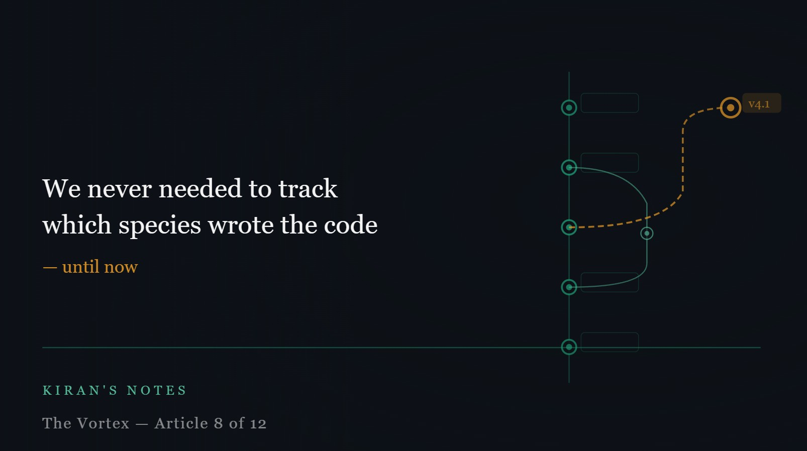

# We never needed to track which species wrote the code — until now

*Kiran's Notes — The Vortex, Article 8 of 12*

**Published in**: *Kiran's Notes* (LinkedIn Newsletter)  
**Original URL**: [LinkedIn Newsletter](https://www.linkedin.com/newsletters/kiran-s-notes-7449344281594585089/)  
**Companion Graphic**: [TheVortex-08.jpeg](../assets/TheVortex-08.jpeg)  
**Author**: Kiran Kumar ([@goelkiran](https://github.com/goelkiran) / [LinkedIn](https://www.linkedin.com/in/kirangoel))  

---

  

Software versioning is one of the quieter achievements of the engineering profession. The idea that every change to a codebase should be recorded — who made it, when, what it changed, why — seems obvious in retrospect. But it took decades of painful experience with unmaintainable systems before the industry converged on it as a standard practice.

We version libraries. We version APIs. We version database schemas. We tag releases. We maintain changelogs. We record the commit message that explains why a function was changed at 11pm on a Tuesday in 2019.

What we have never thought to record is which kind of mind wrote the code.

We did not need to. All developers were, as far as the versioning system was concerned, functionally equivalent instances of the same species. Homo sapiens, roughly consistent cognitive architecture, trained through roughly similar educational and professional processes. The variance mattered at the individual level — a senior engineer's commit carries different implicit assumptions than a junior engineer's — but the species was constant. It did not need a version number.

That assumption is now breaking down.

---

## Models evolve faster than developers do

A human engineer's capabilities change slowly. Training, experience, mentorship, deliberate practice over years — these produce meaningful growth, but on a timescale of years to decades. The engineer who joins a team today will be meaningfully more capable in five years, but the change is gradual and largely continuous.

Foundation models evolve on a completely different timescale. The gap in reasoning quality, security awareness, edge-case handling, and architectural judgement between a model from eighteen months ago and one from today is not small. It is substantial. And it is not linear — capability can shift discontinuously when a new training approach or scale threshold is crossed.

This means that a codebase partially authored by an agent running on a model from two years ago is a genuinely different artefact than one authored by an agent running on a current model. The older sections may have blind spots that the current model would not have. They may reflect assumptions about security, performance, or correctness that have since been superseded.

We have no way to represent this in our version control today. The commit records who pushed the change and when. It does not record which generation of model participated in writing it.

---

## Why this matters for audit and compliance

In regulated industries — and I have spent my career in one, building data platforms for investment management firms — the question of auditability is never abstract. Regulators want to know not just what a system does, but how it was built, who was responsible, and what assurances exist about its reliability.

Currently, that question has a human answer. A development team signed off on the code. Named individuals were accountable. The audit trail connects decisions to people.

As agentic AI takes on more of the development work, that human answer becomes less complete. The named individual may have reviewed and approved, but did not write. The model that generated the first draft of a critical function is not recorded anywhere in the commit history.

This is not an imaginary concern. It is a gap that regulators in financial services, healthcare, and other governed industries will eventually notice and address. Better to build the practice before we are required to.

---

## What model provenance could look like

I am not proposing a fully formed standard here — this is genuinely open territory. But the shape of a solution is not hard to sketch.

At minimum, development tooling should record which model or agent assisted in generating or significantly modifying a piece of code. Not as a replacement for human accountability — the human who reviewed and committed still owns the decision — but as supplementary metadata. Model name, version, and date of the model used.

This has practical consequences beyond compliance. When a security vulnerability is discovered that traces to a specific reasoning pattern in a particular model generation, you would be able to identify which parts of your codebase are at risk. When a model is deprecated or found to have systematic blind spots, you would know where to audit first.

Think of it as a bill of materials for your software, extended to include the cognitive tools that shaped it. We already track which third-party libraries a system depends on, and we respond when vulnerabilities are found in those libraries. The reasoning capability of the model that wrote the code is not so different from a library dependency — it shapes the behaviour of the system, and its limitations deserve to be understood and tracked.

---

## The species assumption, made visible

There is something philosophically interesting about this moment.

When we built version control systems, we embedded an assumption so deep we never stated it: that the entity making changes was always a human being of a known and stable cognitive type. The assumption was so reliable that it was invisible. Of course it is a human. What else would it be?

That assumption is now visible precisely because it is no longer fully reliable.

We did not need to record which species built the code because there was only one species building it. We assumed we were all sapiens. However, the minds participating in software development are no longer cognitively uniform. They vary in architecture, training, capability, and limitation in ways that are meaningful and that change rapidly over time.

Recording that variation is not a bureaucratic overhead. It is the minimum required to maintain the kind of accountability that responsible software development demands.

*Next: Speed without sight — why regulatable AI is not a feature, it's a requirement.*

---

---
*#SoftwareVersioning #AIGovernance #Compliance #DataEngineering #AuditTrail #KiransNotes #TheVortex*
