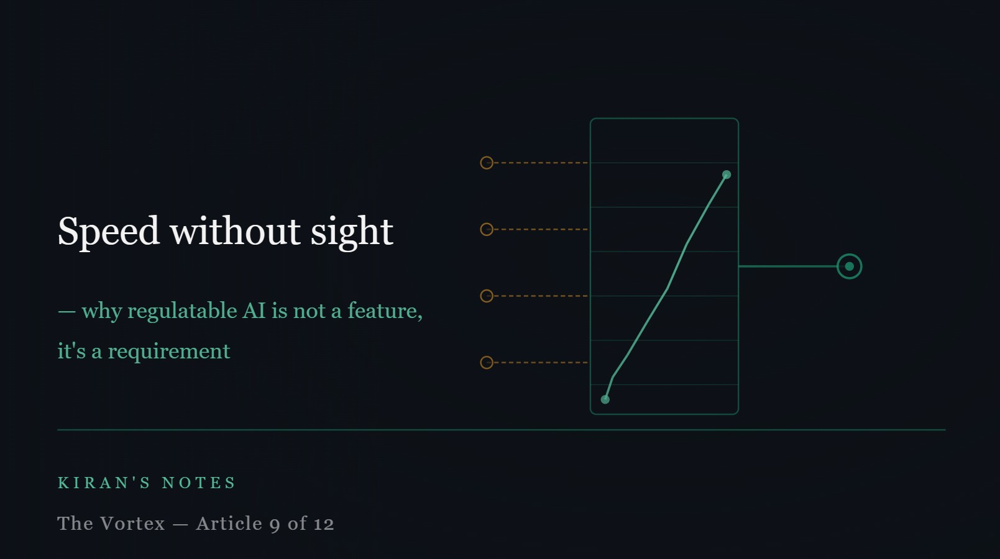

# Speed without sight — why regulatable AI is not a feature, it's a requirement

*Kiran's Notes — The Vortex, Article 9 of 12*

**Published in**: *Kiran's Notes* (LinkedIn Newsletter)  
**Original URL**: [LinkedIn Pulse](https://www.linkedin.com/pulse/speed-without-sight-why-regulatable-ai-feature-its-kiran-kumar-raufc/)  
**Companion Graphic**: [TheVortex-09.jpeg](../assets/TheVortex-09.jpeg)  
**Author**: Kiran Kumar ([@goelkiran](https://github.com/goelkiran) / [LinkedIn](https://www.linkedin.com/in/kirangoel))  

---

  

There is a version of the agentic AI story that goes like this: AI systems are becoming capable enough that human oversight is becoming a bottleneck. The future belongs to systems that act faster than any human review process can follow. Governance is friction. Interpretability is a luxury. Speed is the competitive advantage.

I understand the appeal of this story. I have sat in enough budget conversations to know that "move faster" is a more persuasive argument than "move carefully."

But I think this version of the story is wrong — and not just philosophically. It is practically wrong in a way that will become very expensive for organisations that believe it.

---

## A concrete example from a different domain

In 2020, a research team at Texas A&M published a paper at the International Conference on Autonomous Agents and Multiagent Systems that I have been thinking about ever since. James Ault, Josiah Hanna, and Guni Sharon were working on a problem that might seem remote from enterprise software: optimising traffic signal controllers at a real signalised intersection.

The obvious technical approach was a deep neural network. Deep Q-learning had already demonstrated reductions of up to 73% in vehicle delays compared to fixed-time controllers. Impressive numbers. But there was a problem: transportation agencies — quite reasonably — require that signal controllers be interpretable and regulatable. A black-box controller that occasionally makes inexplicable decisions at a live intersection, where driver safety is at stake, is not deployable regardless of its average performance.

So Ault and colleagues set out to answer a different question: can you build a controller that is both interpretable — where every decision can be traced to a specific, monotonic relationship between inputs and outputs — and competitive with a deep neural network?

The answer was yes. Their DRHQ variant, a regulatable Q-learning approach, reached competitive performance with the DNN-based controller, with up to 19.4% reduced delays compared to standard actuated controllers. Not despite being interpretable. Alongside it.

The lesson I take from this is not that interpretability always preserves full performance. Sometimes it does cost something. The lesson is that interpretability is a design choice, not a fundamental trade-off — and that the engineering community has barely begun to explore what is possible when we treat it as a first-class requirement rather than an afterthought.

---

## What regulatable means, precisely

The term "interpretable AI" is used loosely enough to be almost meaningless. What Ault et al. defined more precisely is something they called a *regulatable* control function: one where the relationship between each input variable and the output is monotonic. If the number of stopped vehicles increases, the precedence for granting that phase the right of way should either always increase or always decrease — never unpredictably flip.

This means a human operator can look at the system's decision and construct a meaningful explanation: right of way was granted to the southbound lane because the number of stopped vehicles there increased while the eastbound queue cleared. They can also intervene meaningfully: if this intersection has a specific characteristic that the model is not weighing correctly, they can adjust the relevant parameter.

That is what regulatable means in practice. Not "a human can look at the weights of the neural network." Not "we can generate a post-hoc explanation using a secondary model." It means: a human can understand, predict, and adjust the system's behaviour using domain knowledge, without needing to retrain anything.

In enterprise data systems — which is my domain — this is not a nice-to-have. Investment management firms operate under regulatory frameworks that require exactly this kind of explainability. When a data pipeline makes a decision that affects a fund's reported positions, someone needs to be able to explain that decision to a regulator. "The model decided" is not an acceptable answer.

---

## The governance gap we are walking into

Here is what concerns me about the current trajectory of agentic AI adoption in enterprise settings.

Most organisations are adopting AI-assisted development at a pace that outstrips their governance frameworks. The tools are available, the productivity gains are real, and the pressure to move quickly is intense. The governance conversation — who is accountable for what this agent does, how do we audit its decisions, what happens when it is wrong — is being deferred.

This is understandable. Governance conversations are slower than tool adoption conversations. But the gap between capability and accountability is accumulating. And when it is eventually addressed — by a regulator, by an incident, by a failure that traces back to an AI decision that nobody could explain — the retrofit will be expensive.

The organisations that will navigate this well are the ones that are asking the governance questions now, alongside the capability questions. Not "can we use agentic AI for this?" but "can we use agentic AI for this in a way that we can stand behind?"

---

## Interpretability and performance are not enemies

The traffic signal paper matters to me because it is a proof of concept from a safety-critical domain. If you can build a regulatable AI controller for a live intersection — where the stakes are driver safety and the system must operate in real time — you can build regulatable AI for enterprise data workflows.

The engineering challenge is real. Designing systems that are interpretable by design, rather than explaining them after the fact, requires deliberate choices about architecture, training objectives, and evaluation criteria. It is harder than deploying a black-box model and hoping for the best.

But it is not impossible. And in regulated industries, it is not optional.

The vortex is spinning faster. Speed without sight is not an advantage. It is a liability waiting to be realised.

*Next: The stack is losing ground — what do we call the engineer who remains?*

---

*Reference: Ault, J., Hanna, J.P., & Sharon, G. (2020). Learning an Interpretable Traffic Signal Control Policy. Proceedings of the 19th International Conference on Autonomous Agents and Multiagent Systems (AAMAS 2020). arXiv:1912.11023*

---
*#InterpretableAI #AIGovernance #RegulatableAI #DataEngineering #FinancialServices #KiransNotes #TheVortex*
