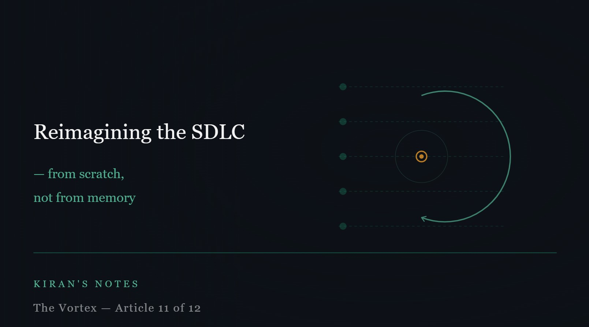

# Reimagining the software development lifecycle — from scratch, not from memory

*Kiran's Notes — The Vortex, Article 11 of 12*

**Published in**: *Kiran's Notes* (LinkedIn Newsletter)  
**Original URL**: [LinkedIn Newsletter](https://www.linkedin.com/newsletters/kiran-s-notes-7449344281594585089/)  
**Companion Graphic**: [TheVortex-11.jpeg](../assets/TheVortex-11.jpeg)  
**Author**: Kiran Kumar ([@goelkiran](https://github.com/goelkiran) / [LinkedIn](https://www.linkedin.com/in/kirangoel))  

---

  

The software development lifecycle we use today was not designed. It was accumulated.

It is a layered deposit of responses to problems encountered over fifty years of building software — with human teams, at human speed, within human cognitive limits. Waterfall came first, then structured methods, then agile, then DevOps, then continuous delivery. Each layer was added to address the failures of the previous one. Each one made things better, on average, for the teams and contexts in which it emerged.

What we have never done is start from first principles and ask: if we were designing a development process today, knowing what we know, with the participants we now have — what would it look like?

I am not going to answer that question fully in a single article. But I want to sketch the shape of an honest attempt.

---

## What the current SDLC is optimised for

If you look at the ceremonies, artefacts, and checkpoints of a typical modern software development process — sprint planning, daily standups, code review, QA cycles, staging environments, release approvals — almost every one of them exists to compensate for a specific human failure mode.

Sprint planning exists because humans lose sight of priorities over time and need regular recalibration. Daily standups exist because human teams in different locations lose coordination without deliberate touchpoints. Code review exists because humans introduce errors that they cannot see in their own work, and another pair of human eyes catches them. QA cycles exist because developers, under pressure, cut corners that testers find. Release approvals exist because deploying software is risky when the person who built it and the person who maintains production are different humans with different contexts.

These are not arbitrary rituals. They are calibrated responses to the actual failure patterns of human software development teams. They exist because, without them, things went wrong in specific, observable ways.

The question I am now asking is: which of these failure patterns still apply when an agent is a significant participant in the development process? Which ones become more important, not less? And which ones are we performing purely out of habit?

---

## What a redesigned SDLC might preserve

Some things do not change, and it would be naive to think otherwise.

The need for human-defined intent does not diminish. Someone — a human — needs to understand the problem well enough to specify what should be built, and to evaluate whether what was built solves the actual problem rather than the stated one. This is not a mechanical step. It requires domain knowledge, stakeholder understanding, and the ability to ask questions that the specification does not answer. Agents are getting better at generating specifications, but they are generating them from the input they are given. The quality of that input is still a human responsibility.

The need for accountability does not diminish. In regulated industries — and most enterprise software eventually touches something regulated — someone needs to be able to sign their name to the behaviour of a system. That signature requires understanding. You cannot sign for something you cannot explain. The accountability chain must remain intact regardless of how much of the implementation was generated.

The need for adversarial evaluation does not diminish — it intensifies. As I argued in the testing article, when the coder and the tester share assumptions, testing becomes confirmation. The adversarial gap between implementation and evaluation needs to be deliberately maintained and possibly widened when both are AI-assisted.

---

## What a redesigned SDLC might release

Some things are worth questioning honestly.

The two-week sprint, as a universal cadence, was calibrated to human planning horizons and human delivery capacity. An agentic system can iterate on a well-specified requirement in hours. The sprint boundary was never a technical constraint — it was an organisational one. When AI substantially compresses delivery time, the question of what cadence actually serves the team — rather than what cadence was inherited from a manifesto written in 2001 — deserves a genuine answer.

The code review, as currently practised, was designed around human readers checking human-written code for human errors. When the code is substantially generated, what is the reviewer actually checking? The answer should shift toward intent verification — does this code do what we meant? — and away from syntax and style checking, which agents can handle trivially.

The multi-stage testing pipeline — unit tests, integration tests, end-to-end tests, UAT — was designed because different kinds of human errors surfaced at different stages. When the error profile changes, the stage design should change too. Some stages may become more important. Others may be automatable in ways that change what human attention is needed at each one.

---

## The framework I am working toward

I do not have a finished methodology to offer. What I have is a set of principles that I am trying to apply in my own team's work:

1. Design around accountability, not just delivery. Every artefact and checkpoint should have a clear answer to the question: who is responsible for this, and can they explain it?

2. Separate intent from execution. The human contribution concentrates in specification and evaluation. The agent contribution concentrates in execution. The process should make this separation legible, not obscure it.

3. Maintain adversarial distance. The entity that generates should not be the entity that validates. This applies to models as much as to human roles.

4. Build provenance in from the start. Which model, which version, which human reviewed and approved — this should be recorded, not reconstructed after the fact.

5. Review for intent, not for style. Code review in an AI-assisted world is a semantic activity, not a syntactic one.

None of these are revolutionary. They are extensions of principles that good engineering teams already try to follow. What changes is which ones need to be made explicit, because the process no longer enforces them by default.

*Next: The vortex is bright — and it's spinning faster than we planned.*

---

---
*#SDLC #SoftwareEngineering #AgenticAI #DevOps #TechLeadership #KiransNotes #TheVortex*
