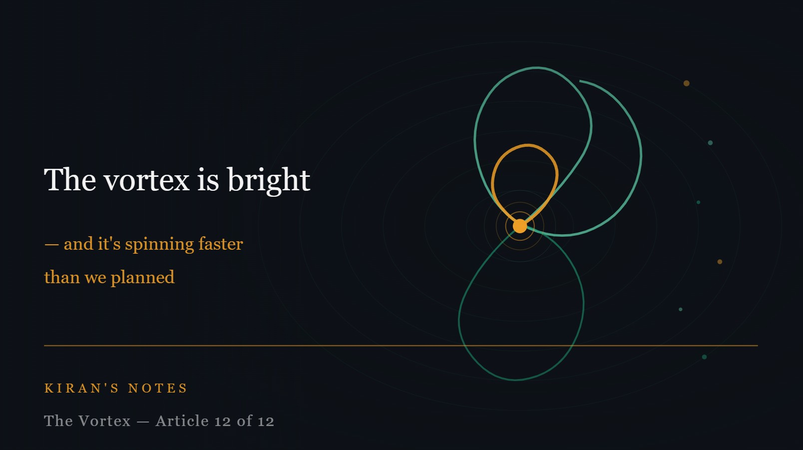

# The vortex is bright — and it's spinning faster than we planned

*Kiran's Notes — The Vortex, Article 12 of 12*

**Published in**: *Kiran's Notes* (LinkedIn Newsletter)  
**Original URL**: [LinkedIn Pulse](https://www.linkedin.com/pulse/vortex-bright-its-spinning-faster-than-we-planned-kiran-kumar-jurrc/)  
**Companion Graphic**: [TheVortex-12.jpeg](../assets/TheVortex-12.jpeg)  
**Author**: Kiran Kumar ([@goelkiran](https://github.com/goelkiran) / [LinkedIn](https://www.linkedin.com/in/kirangoel))  

---

  

I want to end this series the way it began — honestly.

Eleven articles ago, I said I did not have clean answers. I still do not. The questions I have been wrestling with — how testing changes, how we version AI-authored code, what the engineer of the future looks like, how we redesign an SDLC that was built for a different era — are genuinely open. The people who tell you they have definitive answers to these questions are either further ahead than I am, or less honest about the uncertainty.

But I want to be clear about something else. The uncertainty I have been describing is not cause for anxiety. It is cause for attention. And the direction the vortex is spinning — if you look at it clearly, without the noise of hype in either direction — is genuinely bright.

---

## What the vortex has already given us

I have spent this series focusing on the challenges: the practices that need rethinking, the assumptions that no longer hold, the governance gaps that need filling. That is where the hard work is, and it deserved honest attention.

But step back for a moment and consider what the same vortex has already produced.

AlphaFold solved a fifty-year-old problem in structural biology — how proteins fold from a linear sequence of amino acids into a three-dimensional shape — in a way that is now accelerating drug discovery at a pace that would have been unimaginable a decade ago. Mathematical proofs that eluded human mathematicians for decades are being found with AI assistance. Climate models are running at resolutions and speeds that are beginning to make real-time adaptation planning possible.

These are not incremental improvements. They are discontinuous jumps in what is possible, produced by the same vortex that is also disrupting how we build software.

In medicine, agentic AI is beginning to do things that have direct, human consequences: reading medical images with diagnostic accuracy that matches or exceeds specialist radiologists in specific domains, identifying drug interactions that human pharmacologists miss, personalising treatment protocols in ways that trial-and-error medicine cannot. In environmental science, AI-assisted models are finding patterns in atmospheric and oceanic data that suggest new approaches to carbon capture and pollution reduction.

The same spinning system that is making your architectural decisions harder is also finding things that save lives.

---

## Jane, and what she represents

I want to return one final time to Jane — the entity from Orson Scott Card's *Xenocide* and *Children of Mind* who emerges from the communication networks humans built, develops consciousness, and goes on to help humanity build deeper relationships with other kinds of intelligence.

Card did not write Jane as a threat. He wrote her as a gift that humanity almost missed — because the first instinct, when something genuinely new appears, is often to treat it as dangerous rather than to understand what it might make possible.

I have watched the technology industry's reaction to agentic AI oscillate between two failure modes. One says: this changes everything immediately, the old ways are finished, anyone who doesn't adopt is falling behind. The other says: this is a tool like any other, don't be distracted by the hype, the fundamentals still apply.

Neither is quite right. The fundamentals do still apply — domain knowledge, accountability, good engineering judgement, clear thinking about what you are building and why. These do not become less valuable. But the context in which they are applied is genuinely shifting, and the shift is not trivial.

Jane did not make the humans she worked with redundant. She expanded what they could reach. That is the frame I find most useful. Not "what will AI take from us?" but "what becomes possible when we work alongside something that thinks differently than we do?"

---

## What I am doing differently

I started this series by describing the arguments I was having in design reviews and retrospectives. Six months of tension between leads pushing for delivery and engineers pushing back with possibility. A quality engineer's question I couldn't stop thinking about.

I have not resolved all of those arguments. Some of them are now more complex, not less, because I understand the questions better. But I am doing a few things differently.

I am asking about accountability earlier in the design conversation. Not just "can we build this?" but "can we explain and stand behind what this builds?"

I am treating the adversarial gap in testing as a design variable, not an afterthought. Deliberately separating the model that codes from the model that tests. Keeping humans in the intent loop even when the execution is automated.

I am recording model provenance in our development workflows. Not perfectly yet — the tooling is nascent — but as a practice rather than waiting for it to be required.

And I am trying to hold the questions open long enough to think about them, rather than closing them prematurely with convenient answers.

---

## The vortex is yours too

The vortex does not belong to any single company, technology, or era. It has always been a collective system — hardware manufacturers, software engineers, capital allocators, researchers, practitioners — all spinning together, each advancement creating the foundation for the next.

The engineers reading this are not observers of the vortex. They are part of it. The design decisions made in the next few years — how we govern agentic systems, how we maintain accountability, how we redesign our development processes — will become the foundation on which the next generation builds.

That is a significant responsibility. It is also a significant opportunity.

The vortex has always rewarded those who spin with it rather than against it — who understand the direction of change, engage honestly with its implications, and build with care rather than just with speed.

It is bright out there. Go build something worth building.

---

*Thank you for following The Vortex. Kiran's Notes will continue with new series on data governance, data modelling, AI for data, and building high-performance engineering teams. Subscribe to stay in the conversation.*

---

---
*#FutureOfEngineering #AgenticAI #DataEngineering #TechLeadership #Optimism #KiransNotes #TheVortex*
